 # 🌐 Проект мессенджера на Websocket
 ## Описание технологий, архитектуры

**Онлайн-чат для общения между пользователями в режиме реального времени
с использованием технологии websocket.**

Стек технологий:
1. Python (версия 3.14) (асинхронный стиль);
2. PostgreSQL;
3. Redis;
4. Mongodb;
5. Docker-Compose;
6. Poetry;
7. HTML+CSS+JS.

`Frontend` был написан с использованием стека HTML+CSS+JS. В проекте на данном этапе
существует 3 страницы: 
* окно авторизации / регистрации;
* главное меню с чатами, комнатами;
* админ панель.

`Backend` и основная логика чата была написана с использованием языка python и framework-а Fastapi.

**Немного об архитектуре проекта**.

Архитектура программного обеспечения была написана с использованием принципов **Layered Architecture**.
Для взаимодействия между клиентом и сервером используются:
* RESTapi (архитектурный стиль);
* Протокол Websocket (для общения в режиме real-time).

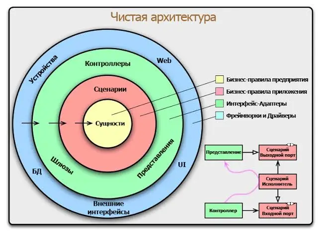

**Паттерны проектирования**. В проекте используются следующие архитектурные паттерны на 
уровне классов и методов:
* Unit of work;
* Domain Event;
* Pub/Sub (Publish/Subscribe);
* MVP;
* DTO;
* Dependency Injection;
* Repository;
* Data Mapper.

## Описание сущностей и функций

В качестве основных сущностей программного обеспечения можно выделить следующие:
* Пользователи (User);
* Чаты (Chats);
* Комнаты (Rooms);
* Сообщения (Message).

Функции, которые реализует программное обеспечение:
* Auth на основе JWT токенов (access + refresh);
* Аутентификация(авторизация) и регистрация пользователя;
* Обновление/удаление пользователя;
* Создание/удаление приватного чата с другим пользователем;
* Создание/удаление комнаты с несколькими пользователями;
* Смена роли пользователей в комнате;
* Выпуск invite токена для вступления в комнату;
* Удаление участников из комнаты;
* Отправка/редактирование/удаления сообщений;
* Ответ на сообщения;
* Пересылка между чатами сообщения;
* Отправка медиа-файлов в чат;
* Отправка голосового сообщения в чат;
* Поиск чатов;
* Просмотр профилей других пользователей в чате;
* Просмотр статусов пользователей online/offline;
* Отправка кода подтверждения по email, после авторизации/регистрации;
* Отправка сигналов и сообщений по websocket:
  * создание/удаление чата;
  * отправка/удаление/редактирование сообщений;
  * изменения статуса пользователя online/offline;
  * добавление/удаление пользователя (в/из) комнат(у/ы);
  * редактирование/удаление пользователя.
* Формирование отчетов и статистики работы программы;

Группы пользователей:
1) Обычный пользователь;
2) Админ;
3) Супер-админ.

Для обычных пользователей:
* login и регистрация в системе;
* просмотр своих чатов;
* создание чатов/комнат;
* редактирование информации о себе;
* вступления в комнату по ссылки;
* отправка сообщений;
* редактирование своих сообщений;
* удаление своих сообщений;
* просмотр профиля с краткой информацией о собеседнике;

Для админов:
* все, что может обычный пользователь;
* просмотр (печать) статистики работы чата;
* управление пользователями:
  * создание;
  * редактирование краткой информации;
  * отправка сообщений по email;
  * удаление пользователя;
  * отзыв всех auth токенов (пользователю придется перезайти);
  * изменить роль;
  * просмотр полной информации о пользователе.

Для супер-админов:
* все, что может админ;
* просмотр аудит действий пользователей;
* создание/удаление других админов;

## Screenshots страниц

Окно авторизации и регистрации. Флаг "**Режим разработчика**" нужен для того, 
чтобы зайти в чат без отправки кода подтверждения:

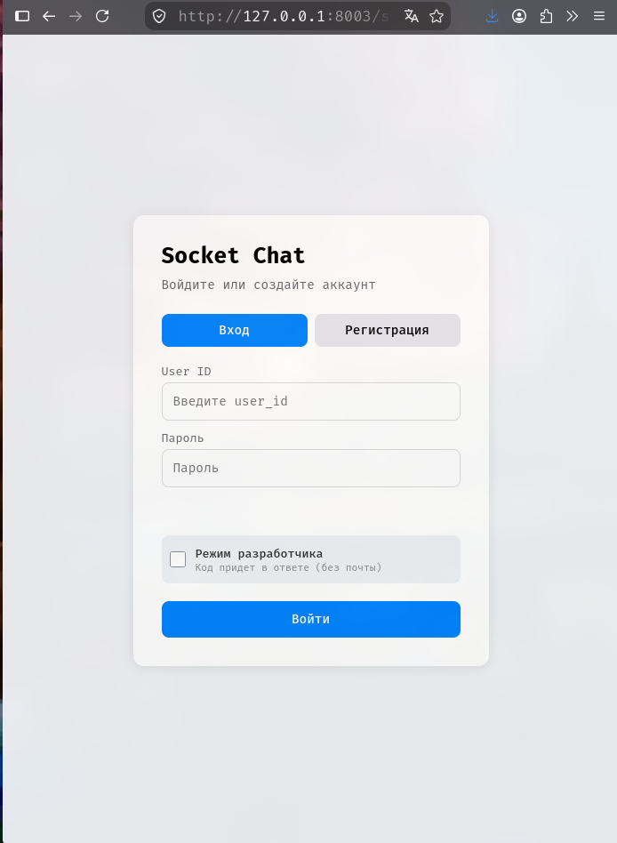

Главное меню с чатами. Адаптивно под смартфоны и пк.

Под смартфон:

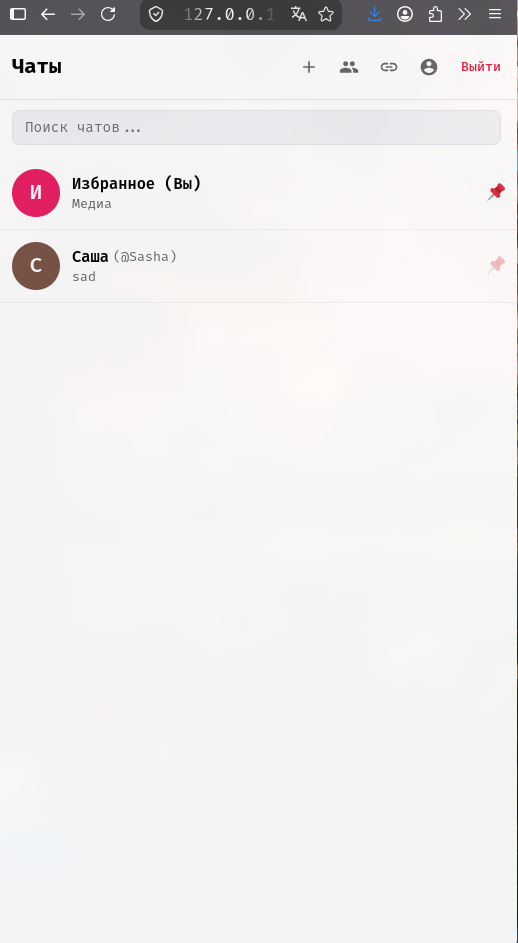 

Под ПК:

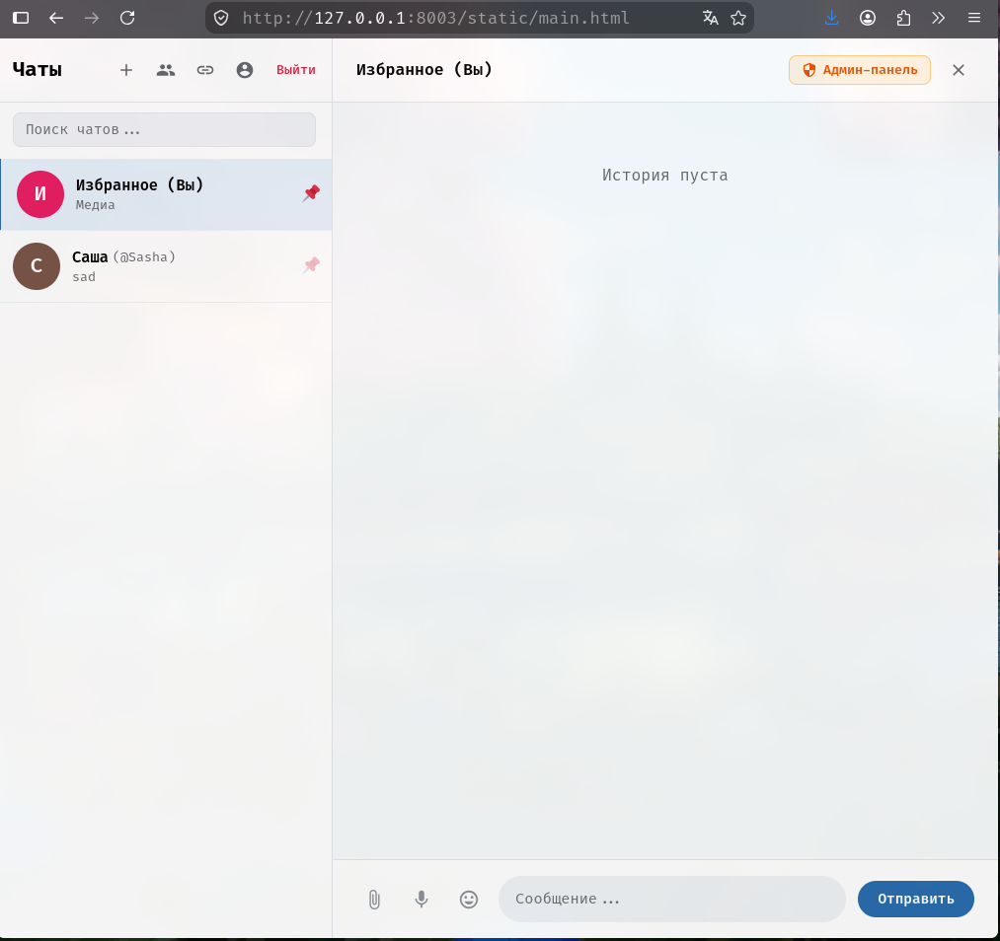

Админ панель:

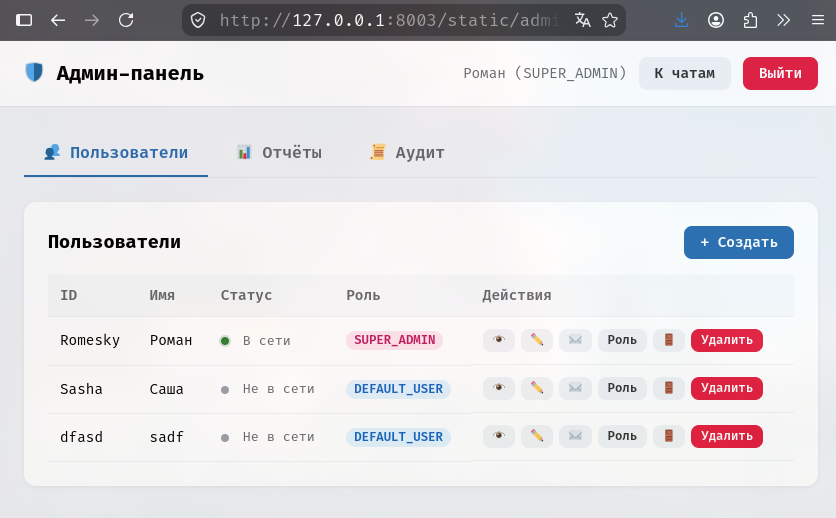

Другие:

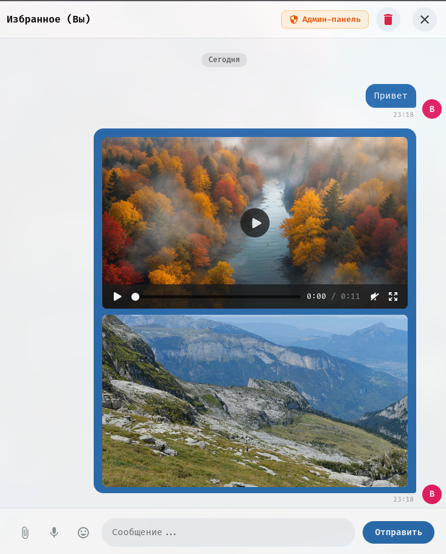

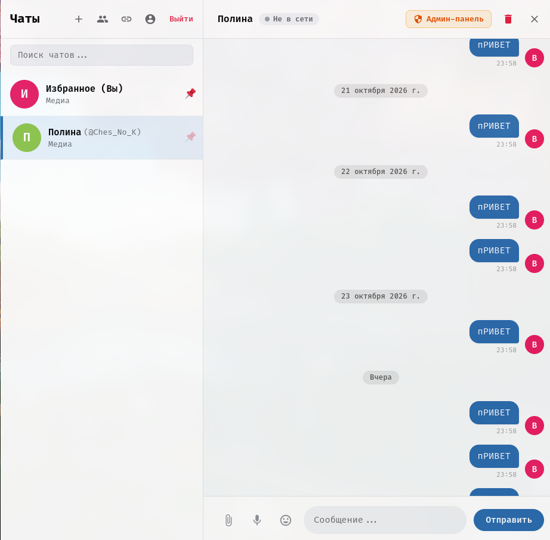

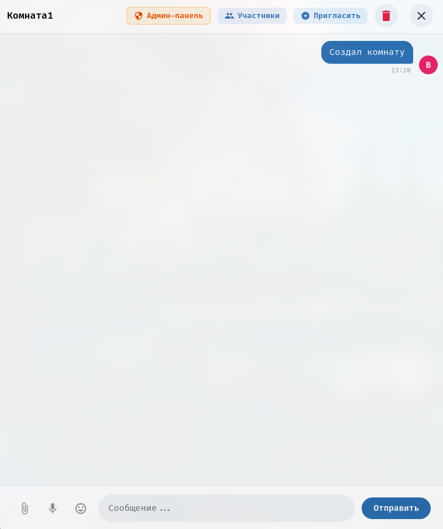

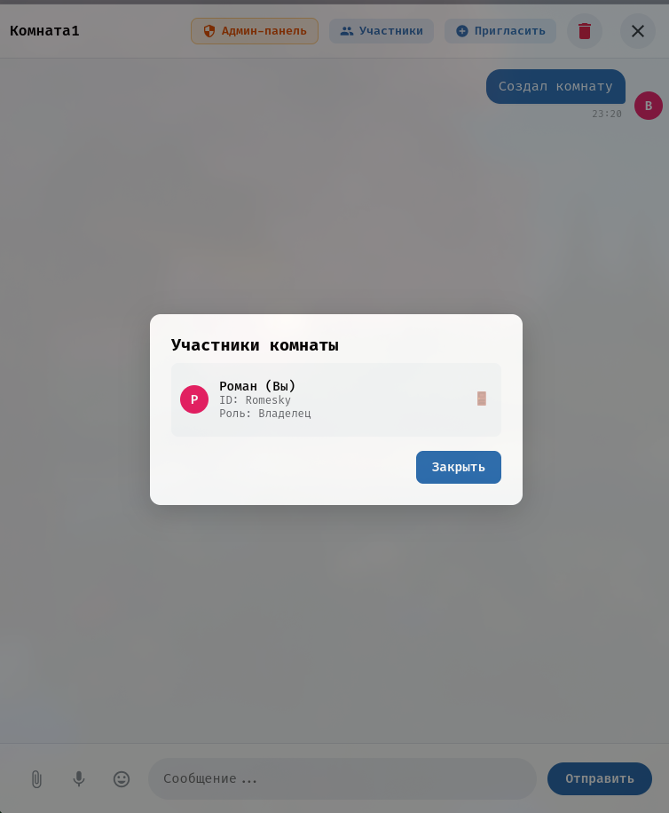

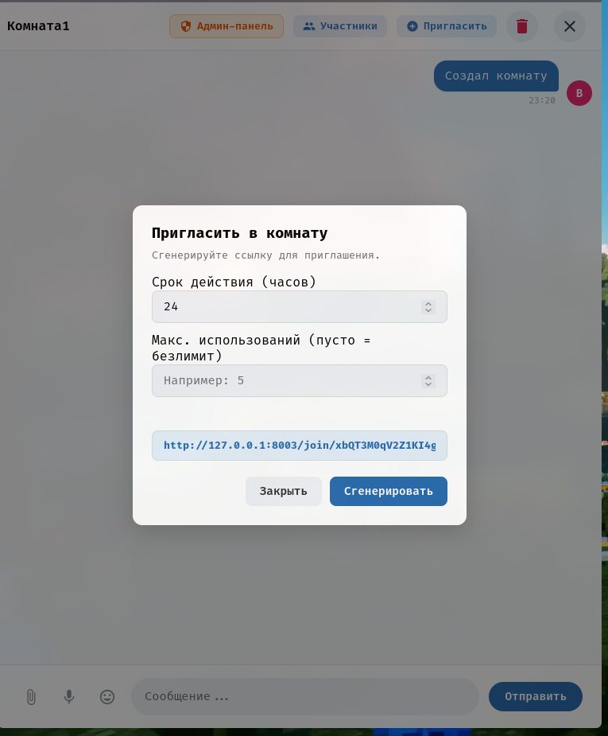

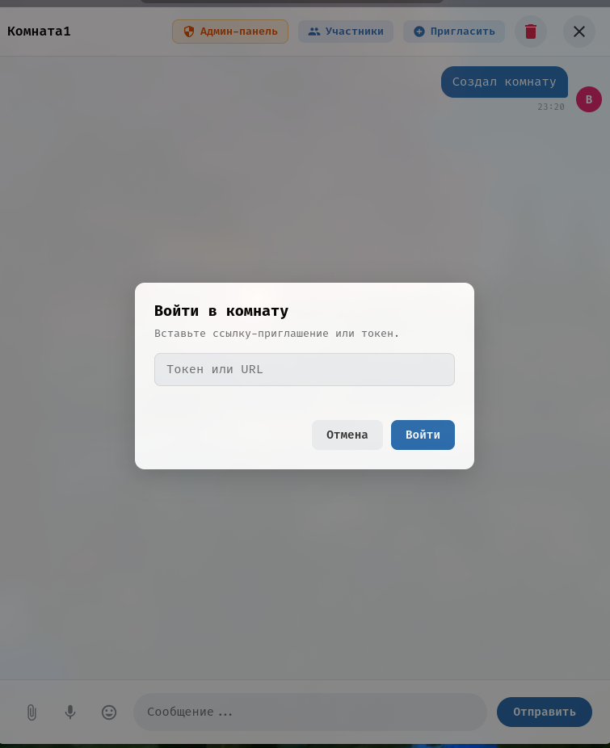

